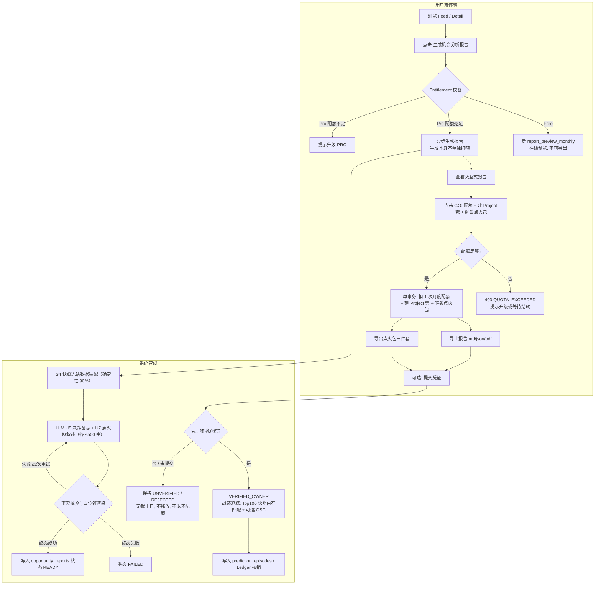

# 09 — 机会研究与商业分析报告规格（Opportunity Report Spec）

Status: Draft ｜ Owner: 后端/产品 ｜ Last reviewed: 2026-10-18（对齐 PRD v3.1：GO = 配额 + Project 壳 + 点火包；凭证核验可选）｜ 依赖：00-INDEX、01 F8、03 §8/§12、05 §11、07、08、13 ｜ 被依赖：10、13、16

---

## 1. 目的与定位

机会研究与商业分析报告（Opportunity Research Report）把一个经过验证的高价值搜索机会（`BUILD_NOW` 或 `EARLY_BET`），转化为一份**权威、客观、结构化且数据密集的商业决策卷宗**。

**核心定位**：F8 有**两件交付物**，同一份冻结快照装配，同一次原子 GO 解锁（PRD §1.8 第 5 条 / ADR-018）。
- **交付物一 —— 机会研究报告**：出海 Builder 的立项验资机与决策备忘录。它直接回答“为什么值得做、商业变现的真实底线在哪里、SERP 留下的具体切入空隙是什么、做成什么形态阻力最小、什么情况下必须立刻止损”。
- **交付物二 —— 形态点火包（Launch Kit）**：用户点击 GO 并扣除 1 次配额后导出的**工程规范与词表**，面向 Cursor / Claude Code 等既有工具链。三件套：`CLAUDE.md` / `.cursorrules`、PSEO 路由词表、着陆页骨架。
- **全链路业务闭环**：打通“机会发现 → GO 立项 → 确定性证据装配 + 决策备忘生成 → 双交付物导出 → 可选凭证核验 → 战绩回流账本”的完整商业流。

> **关于 ADR-008 的边界（必须读清）**：产品**不内置**代码执行引擎、不写用户仓库、不提供 MCP 服务——这一点从未改变。但“不内置执行引擎”**不等于**“不交付工程规范”。点火包是**确定性模板装配**：结构完全由模板 + 已冻结快照生成，硬数据（价格、天数、计数、SERP 排名）由占位符注入，LLM 只负责 ≤ 500 字的叙述文本（08 U7）。它不生成虚构的代码正文与架构图，因此既不会漂移，也不需要维护一套代码生成管线。原 ADR-008 把这两件事捆在一起否掉了，PRD v2.1 推翻了后半句（见 00-INDEX ADR-008 / 019）。

---

## 2. 业务逻辑全景闭环



### 业务闭环六大原则：
1. **配额单闸门（GO）**：Pro 的报告**生成**不单独扣额（只做 `check`），配额的唯一扣减入口是点击 GO 时的**原子事务**——「扣 1 次月度 GO 配额 → 建 Project 壳 → 解锁该裁决的点火包」三件事要么全成要么全不成。若把"GO"与"导出"拆成两个闸门，绕过 API 直接调导出就能白拿点火包（13 §4.3、10 §4）。Free 走 `report_preview_monthly` 预览额度，且不包含 `atomic_go_export_monthly`，无法进入 GO 路径。
2. **数据确定性闭环**：报告 90% 的内容（D-M-W 拆解、关键词图谱、SERP 弱结果列表、竞品真实价格）直接从每日已封存的 `opportunity_snapshots` 确定性拉取，杜绝 LLM 幻觉。快照中的分类标签在**入库时即已冻结**（ADR-020），因此同一快照永得同一份报告。
3. **轻量文本生成（LLM U5 / U7）**：仅由 LLM 输出 ≤ 500 字的高管决策备忘（Why Now、目标客群画像、差异化切入点、风险评级）与 ≤ 500 字的点火包叙述；所有硬事实强制绑定证据占位符，由确定性渲染注入（08 §6）。
4. **幂等与多格式导出闭环**：同一用户在同一数据快照日对同一机会的请求完全幂等，已生成的报告直接复用；报告支持 Markdown、JSON、PDF 三种格式导出，点火包支持 Markdown / YAML / JSON 三件套导出。
5. **凭证核验闭环（可选）**：GO 后用户可提交**四类凭证之一**（独立域名 / 着陆页、DNS TXT、应用商店 OAuth、GitHub 仓库文件 / Release asset）。**没有截止日**：未提交或核验失败只让项目保持 `UNVERIFIED` / `REJECTED`，不释放任何资源、不退还配额、也不影响项目存在；只有 `VERIFIED_OWNER` 才进入公开战绩、North Star 与 Gate 1 统计。
6. **交付物确定性（点火包）**：点火包的每一个字段都能追溯到一份已冻结快照与一个模板占位，可离线重算、可审计。它不含虚构代码正文、不含架构图、不写入用户仓库（ADR-019）。

---

## 3. 报告数据结构规范（`schema_version = 1.0`）

报告顶层 Schema 位于 `packages/report/schema/report-1.0.json`：

```json
{
  "schema_version": "1.0",
  "report_id": "rpt_01J...",
  "opportunity_id": "opp_01J...",
  "user_id": "usr_01J...",
  "snapshot_id": "snp_01J...",
  "obs_date": "2026-10-01",
  "scoring_config_version": "sc-1.0.0",
  "locale": "zh-CN",
  "market_country": "US",
  "research_language": "en-US",
  "verdict": "BUILD_NOW",
  "recommended_archetype": "TOOL",
  "execution_class": "S",
  "scores": {
    "d_basis_points": 8200,
    "m_basis_points": 7600,
    "w_basis_points": 8800,
    "confidence": "HIGH"
  },
  "sections": {
    "executive_summary": {},
    "demand_intelligence": {},
    "commercial_evidence": {},
    "serp_weakness_audit": {},
    "strategic_archetype": {},
    "risk_and_kill_criteria": {}
  },
  "citations": {
    "F1": { "type": "SERP", "snapshot_id": "snp_...", "rank": 3, "url": "https://..." },
    "F2": { "type": "PRICING", "evidence_id": "evd_...", "domain": "competitor.com", "price": "$19/mo" }
  },
  "metadata": {
    "generated_at": "2026-10-01T04:35:10Z",
    "generation_duration_ms": 2180,
    "export_count": 0,
    "last_exported_at": null
  }
}
```

---

## 4. 报告六大核心分析板块规范

标注：**[D]** 确定性装配；**[L]** LLM 生成（U5，遵循 08 §6 引用规则）；**[D+L]** 确定性骨架 + LLM 提炼。

### 4.1 §1 Executive Summary（决策备忘录）[L]
- **目标**：30 秒内向创业者/Builder 阐明核心战略逻辑。
- **字段**：
  ```json
  {
    "one_sentence_verdict": "强需求已形成且存在明显 SERP 弱点，但商业变现需保持轻量工具定位以控制获客成本。",
    "why_now": "近 30 天内搜索需求突破临界点，SERP 前三名被 2022 年过时论坛帖占据，大厂尚未介入。",
    "target_persona": {
      "who": "海外中小独立电商卖家 / Shopify 运营人员",
      "pain": "手动计算退税和运费分摊耗时且极易出错",
      "urgency": "每月报税周期前集中高频搜索"
    },
    "core_value_prop": "极简免登录的专用计算器，一键生成符合当地税局要求的报表。"
  }
  ```
- **约束**：必须基于 `[D]` 提供的真实数据，严禁凭空产生无证据支撑的宏大商业叙事。

### 4.2 §2 Demand Intelligence（需求图谱与搜索意图）[D]
- **数据源**：`autocomplete_observations` 与 `opportunity_queries`（机会簇 query 集合，05 §3）。`query_clusters` 表不存在，不得引用（30 R8）。
- **意图**：每个 query 的 `intent` 由 U1 在入库时分类并冻结（ADR-020），报告只读冻结值，不在生成时重新分类。
- **`volume_tier`**：当前没有词量数据源（04 §2），该字段**不输出**；接入经 04 §7 准入的词量源后再启用。
- **字段**：
  ```json
  {
    "primary_query": "shopify tax calculator free",
    "search_intent": "TRANSACTIONAL",
    "demand_trajectory": "ACCELERATING",
    "cluster_keywords": [
      {
        "query": "shopify tax calculator free",
        "intent": "TRANSACTIONAL",
        "priority": "P0",
        "first_observed": "2026-08-15"
      },
      {
        "query": "how to calculate shopify sales tax by state",
        "intent": "INFORMATIONAL",
        "priority": "P1",
        "first_observed": "2026-09-02"
      }
    ],
    "seasonal_notes": "无明显周期性波动，全年稳定"
  }
  ```

### 4.3 §3 Commercial Evidence（商业变现底线与证据）[D+L]
- **数据源**：`commercial_snapshots` 与 `evidence`。
- **字段**：
  ```json
  {
    "m_score_grade": "HIGH",
    "monetization_stage": "PRICED",
    "observed_pricing": {
      "median_monthly_usd": 19.00,
      "price_range": "$9/mo - $49/mo",
      "free_tier_present": true,
      "evidence_cite": "F2"
    },
    "payment_infrastructure": ["STRIPE", "PADDLE"],
    "recommended_routes": [
      { "route": "SAAS_SUBSCRIPTION", "grade": "PRIMARY", "rationale": "同类独立工具均有稳定月度订阅模型" },
      { "route": "ADS_AFFILIATE", "grade": "SECONDARY", "rationale": "可挂接会计软件 Affiliate 链接" }
    ],
    "what_this_proves": "证明已有 3 家独立产品在此领域设置公开定价页并接入真实支付网关。",
    "what_this_does_not_prove": "不证明竞品的具体 MRR 或真实净利润率，需谨慎测算自身流量转化率。"
  }
  ```
- **红线**：严禁把推测数据包装成事实；若 M 轴为 `LOW`，必须醒目标注“商业化真实性待进一步测试”。

### 4.4 §4 SERP Weakness & Indie Competition Audit（竞争格局、搜索断层与中小开发者壁垒审计）[D+L]
- **数据源**：`serp_results`、`serp_weakness_audit` 与开源/生态观测。
- **核心原则（防虚假安全感）**：严禁仅将 Adobe、Google 等大厂作为假想敌；大厂供给错配不代表赛道没有竞争，必须透视**“中小独立开发者的水下涌入密度与技术复制壁垒”**，防范低门槛同质化内卷。
- **展示 Top 10 SERP 穿透证据与中小竞争者透视**：
  ```json
  {
    "w_score_grade": "HIGH",
    "weak_result_ratio": 0.60,
    "weaknesses_identified": [
      {
        "rank": 1,
        "domain": "reddit.com",
        "weakness_type": "UGC_FORUM",
        "title": "Anyone know a good tool for shopify tax?",
        "published_at": "2022-04-10",
        "citation": "F1"
      },
      {
        "rank": 3,
        "domain": "outdated-blog.org",
        "weakness_type": "STALE_CONTENT",
        "title": "5 Tips for Tax in 2021",
        "published_at": "2021-11-03",
        "citation": "F3"
      }
    ],
    "authoritative_competitors": [],
    "indie_competition_audit": {
      "barrier_to_entry": "LOW",
      "barrier_reason": "核心功能基于成熟开源库（如 Wasm/PDF-lib），技术复制成本极低（<2天），中小开发者极易跟进同质化模仿。",
      "indie_entrant_density": "HIGH",
      "density_warning": "SERP 11~30 位及 Chrome 插件商店已观测到多个中小独立新站正在排队爬坡，赛道面临内卷压力。",
      "shadow_channels": [
        {
          "channel": "CHROME_EXTENSION",
          "presence": "DETECTED",
          "observation": "已有 3 款单功能插件瓜分存量高频用户，部分免登录流量已被截流。"
        },
        {
          "channel": "GITHUB_OPENSOURCE",
          "presence": "MODERATE",
          "observation": "存在成熟高星开源 Demo，同类竞品易批量涌现。"
        },
        {
          "channel": "SERP_PAGES_2_3",
          "presence": "DETECTED",
          "observation": "Rank 11-25 出现 4 个低权重（DR<20）中小开发者新站正在排队上词。"
        }
      ],
      "defensive_moat_advice": "严禁开发无壁垒的泛化单功能玩具；必须与高客单垂直场景（如跨境电商对账、法务合规脱敏）或企业工作流（Zapier/Webhook）深度绑定，建立定制化护城河。"
    }
  }
  ```

### 4.5 §5 Strategic Archetype & Build Angle（推荐构建形态与切入策略）[D+L]
- **字段**：
  ```json
  {
    "recommended_archetype": "TOOL",
    "execution_class": "S",
    "estimated_mvp_days": "3-5 天",
    "core_differentiator": "针对论坛用户反映的‘老旧工具不支持 2026 新州税率’，以‘实时最新税率 + 免注册即用’作为核心切口。",
    "suggested_pages": [
      { "path": "/", "purpose": "核心免登录计算器主界面，提供立即可用的交互体验" },
      { "path": "/by-state", "purpose": "按各州税率索引的落地页合集，承接长尾搜索意图" },
      { "path": "/faq", "purpose": "解答报税高频常见问题，建立信任与 Schema 结构化数据" }
    ]
  }
  ```

### 4.6 §6 Risk & Kill Criteria（风险清单与止损红线）[D]
- **直接映射系统中的 Kill DSL（12）**：
  ```json
  {
    "active_kill_rules": [
      {
        "rule_code": "NEW_AUTHORITATIVE_ENTRANT",
        "threshold": "Shopify 官方或 Intuit 推出同名原生内置功能并进入 SERP Top 3",
        "action": "立即停止投放与迭代，转入长尾维护或放弃"
      },
      {
        "rule_code": "W_SCORE_COLLAPSE",
        "threshold": "SERP 弱结果比例跌破 20%（竞争者大量涌入）",
        "action": "审视是否已有先发 SEO 优势，若无则停止进一步投入"
      }
    ],
    "disclaimer": "本报告基于截至 2026-10-01 的公开市场观测数据生成，不构成投资或商业回报保证。"
  }
  ```

---

## 5. 导出规格与交付形态

### 5.1 导出格式一览

| 格式 | 用途 | 交付方式 |
| :--- | :--- | :--- |
| **Markdown (`.md`)** | 开发者个人笔记（Notion / Obsidian）、直接作为自有提示词或 PRD 上下文 | 一键复制到剪贴板；下载为 `{slug}-opportunity-report-v{version}.md` |
| **JSON (`.json`)** | 团队数据集成、自建内部分析管道 | 下载为完整符合 Schema 的 JSON 结构化数据 |
| **PDF (Print / PDF)** | 离线汇报、与合伙人/投资人同步决策 | 网页端一键调用标准排版打印样式（Tailwind print CSS）或直接导出 PDF |

### 5.2 Markdown 报告标准渲染模板样例

````markdown
# 机会商业分析报告：Shopify 免登录税率计算器
> **判定结论**：`BUILD NOW` ｜ **综合置信度**：`HIGH` ｜ **数据基准日**：2026-10-01
> **目标市场**：US (en-US) ｜ **建议形态**：`TOOL` ｜ **执行规模**：S (3~5天)

---

## 一、 决策备忘录 (Executive Summary)
- **核心结论**：强需求已形成且存在明显 SERP 弱点，但商业变现需保持轻量工具定位以控制获客成本。
- **Why Now**：近 30 天内搜索需求突破临界点，SERP 前三名被 2022 年过时论坛帖占据，大厂尚未介入。
- **目标客群**：海外中小独立电商卖家 / Shopify 运营人员。

## 二、 关键得分分解
| 评估维度 | 得分 (基点) | 评级 | 关键事实 |
| :--- | :--- | :--- | :--- |
| **D - 需求形成** | 8200 / 10000 | HIGH | 簇内包含 14 个长尾变体，近 30 天出现加速趋势 |
| **M - 商业真实性** | 7600 / 10000 | HIGH | 观测到 3 家同类产品公开定价（中位数 $19/mo），接入 Stripe |
| **W - 准入窗口** | 8800 / 10000 | HIGH | SERP Top 10 中 60% 为弱结果（Reddit、过时文章） |

## 三、 商业变现证据与底线 (Commercial Evidence)
- **已观测定价**：区间 $9/mo - $49/mo，中位数 $19/mo。
- **已证实支付基础设施**：Stripe, Paddle。
- **本报告证明了什么**：证明已有真实独立开发者与软件厂商在此需求下成功实现付费转化。
- **本报告不能证明什么**：不代表你的产品上线即可自动盈利，最终转化率取决于产品体验与税率准确度。

## 四、 SERP 竞争弱点列表 (Top Weaknesses)
1. **[Rank 1] reddit.com** (2022-04-10) — 论坛问答帖，无交互式计算工具。
2. **[Rank 3] outdated-blog.org** (2021-11-03) — 包含大量过时旧税率，用户评论抱怨频繁。

## 五、 推荐构建形态与落地建议
- **形态推荐**：`TOOL`（无须强制登录，首屏直接交互，计算完毕后引导邮件订阅或高级报表导出）。
- **极简结构建议**：
  - `/`：核心免登录计算器主界面；
  - `/by-state`：按各州税率索引的长尾聚合页面；
  - `/faq`：报税合规问答与结构化标记。

## 六、 风险监控与止损红线 (Kill Criteria)
- [ ] 若 Shopify 官方或 Intuit 在 SERP Top 3 推出同名原生工具，立即终止额外开发投放。
- [ ] 若 SERP 弱结果比例跌破 20%，停止大规模页面扩充。

---
*免责声明：本报告基于 Emeradar 系统截至 2026-10-01 的公开市场客观观测数据生成，不构成任何投资或收益承诺。*
````

---

### 5.3 交付物二：形态点火包（Launch Kit，ADR-019）

点火包**不是**代码生成器，而是**可以从冻结快照离线重算的确定性交付物**。它由模板 + 已冻结快照装配而成，硬数据（价格、日期、计数、SERP 排名、词频）一律由占位符注入；LLM（08 U7）只撰写 ≤ 500 字的叙述段落。**不生成虚构代码正文、不生成架构图、不写入用户仓库、不调用任何代码执行或 MCP 能力。**

| 产物 | 文件名 | 内容来源 | 说明 |
| :--- | :--- | :--- | :--- |
| **① 工程规范** | `CLAUDE.md` / `.cursorrules` | 形态模板 + 报告 §5 + 07 商业证据 | 项目定位、目标客群、技术栈约束、命名约定、SEO 硬要求、"不要做什么"清单（含 Kill Criteria）。供用户**自带**的 Cursor / Claude Code 读取 |
| **② PSEO 路由词表** | `routes.yaml` / `keywords.csv`（同字段 JSON 可选） | `opportunity_queries` 冻结快照 + U1 入库冻结的意图 + 04 采集证据 | 每行字段（与 PRD F8、08 §6.4 统一，30 R9）：`slug` / `target_keyword` / `intent` / `title` / `h1` / `meta_description`，另附 `first_observed` 与 `evidence_id` 供溯源；`title` / `h1` / `meta_description` 由形态模板从关键词与意图确定性装配，不经 LLM。只包含**已观测到**的词，不得外推生成"可能相关的词" |
| **③ 着陆页骨架** | `landing-skeleton.html` + `sections.yaml` | 形态模板 + 报告 §4 SERP 弱点审计 | 区块顺序与文案占位符（`{{F2.price_median}}` 等）；占位符必须在导出时全部解析，残留即刻阻断（R3） |

**硬约束**：
1. **确定性**：同一 `(opportunity_id, snapshot_id, archetype, template_version)` 必须产出 bit-for-bit 相同的点火包；因此点火包头部写入 `scoring_config_version`、`template_version`、`snapshot_id` 三项，供用户自查。
2. **绑定 GO**：点火包**只能**通过 GO 事务解锁，不存在单独的下载端点（ADR-018、10 §4）。未 GO 即无点火包，这是产品定价的前提，不是前端约定。
3. **形态专属**：不同 `archetype`（05 §11.2）装配不同模板；用户 GO 时选择的形态决定解锁哪一套。同一机会的不同形态点火包互不替代。
4. **不含虚构事实**：词表与骨架里出现的每个数字与 URL 都必须能指回 `evidence_id` 或 `snapshot_id`；无法指回的字段留空并标注"—"，**不得由 LLM 补齐**（与 R2 同源）。
5. **本地化边界**：点火包以用户 `ui_locale` 生成叙述文本，但**词表、路由 `slug`、查询词本身保持 `research_language` 原文不译**（14 §点火包本地化边界）。
6. **词表来源与空集处理（30 R8）**：词表**只**从 `opportunity_queries` 读取，由服务层显式传入装配器，不得以"缺省为 `[]`"静默通过（现状代码 `report.section2.clusterQueries` 无人传入，导致词表恒空）。若该机会确实没有观测词，不输出空的 `keywords.csv` / `routes.yaml`，改为输出 `KEYWORDS_UNAVAILABLE.md`，写明原因（如"簇内尚无基线期后的观测词"）与观测起始日；导出页同步提示。`volume_tier` 无来源时不输出。

### 5.4 报告与点火包的关系

| | 交付物一：机会研究报告 | 交付物二：形态点火包 |
| :--- | :--- | :--- |
| 回答的问题 | 值不值得做、底线在哪、什么情况下止损 | 具体做什么、路由怎么铺、交给 Cursor 的规范是什么 |
| 主要读者 | 决策者（自己 / 合伙人） | 执行者（自己 / 协作者 / AI 编码助手） |
| 数据基准 | 同一份 `snapshot_id` | 同一份 `snapshot_id` |
| 解锁方式 | Pro 可生成并预览；导出与点火包同受原子 GO 约束 | **仅**原子 GO 解锁 |
| 无 GO 时 | Free 只能看每月 1 份历史案例预览 | 不可获得 |

---

## 6. 配额、计费与生命周期

1. **配额扣减规则（与 13 §3.2 / §4.3 联动）**：
   - **Free**：`report_preview_monthly = {MONTH, 1}`，只能**在线预览**历史案例报告，**不可导出**、**无点火包**；Free 不含 `atomic_go_export_monthly`，无法进入 GO 路径。免费层的实时体验由 `feed_selected_weekly`（每周 1 条已失去抢跑价值的案例，15 §3）承担，**不是**延迟 45 天的归档。
   - **Pro**：`atomic_go_export_monthly = {MONTH, 3, rollover: true, rollover_cap: 6}`。报告**生成本身不单独扣额**；配额只在点击 GO 的原子事务中扣减一次，同一次扣减同时解锁该裁决点火包并创建 Project 壳。跨月结转只保留一期，有效上限封顶 6 次（13 §4.2）。
   - 历史遗留的 Team 100 份/月不再存在；Team 仅作为历史 `plan_code` 兼容值保留（00 §4.3、13 §3.1）。
2. **GO 的事务边界（不再是 Hold & Release）**：`DecisionService.goAndExport` 在**单个数据库事务**内完成：`reserve` 月度 GO 配额 → 建 Project 壳（`decision_id` 唯一）→ 解锁该裁决点火包。任一步失败则整体回滚；**没有槽位容量检查**，并发 GO 各扣各的配额，同一 `decision_id` 的重复 GO 由唯一约束拒绝。生成报告是**前置只读步骤**，不占配额，失败只需重试。
3. **快照级幂等缓存**：
   - 针对 `(user_id, opportunity_id, snapshot_id)` 形成唯一索引；
   - 用户在当日快照周期内重复查看、下载或导出同一份报告，**零额外配额消耗**；
   - 点火包的幂等键为 `(project_id, archetype, template_version)`，同一项目重复导出不重复扣额（扣额只发生在 GO 那一刻）。
4. **过期与演进标记（`stale`）**：
   - 每天 04:30 批处理后，若机会的 Verdict 发生转移（如 `BUILD_NOW` 降级为 `WATCH`）或触发 Kill criteria，该报告标记为 `stale = true`；
   - 界面友好提示："底层市场数据已于 {最新日期} 发生变化，建议刷新分析"。
   - **注意**：报告变 `stale` 与已建 Project 无关，不会自动撤回项目，也不会退还 GO 配额。
5. **凭证核验与配额解耦**：提交凭证、核验通过或失败都不改变配额与 Project 生命周期；未核验项目只是不进入公开战绩与排名追踪。v3.1 没有 `stake_window_days`、`stake_status` 或槽位释放逻辑。

---

## 7. 验收与质量门禁（9-Point Rubric）

系统自动化校验（阻断项）与人工抽检（每项 1 分，总分 9 分，≥ 8 分且 R1、R2、R9 均满足视为合格）：

| 序号 | 检查维度 | 性质 | 规则描述 |
| :--- | :--- | :--- | :--- |
| **R1** | **引用真实性** | **一票否决** | 报告中引用的所有 SERP 排名、竞品域名必须在系统证据库中有明确对应 `evidence_id` / `snapshot_id`。 |
| **R2** | **严禁编造商业事实** | **一票否决** | 严禁凭空虚构竞品价格、支付网关或用户评价；M 轴为 LOW 时严禁声称“商业模式成熟”。 |
| **R3** | **占位符渲染完整性** | **阻断** | 报告渲染后不得残留未填充的 `{{Fx.field}}` 模板占位符。 |
| **R4** | **SERP 弱点客观性** | **核心** | 弱点列表必须直接映射自 SERP 审计事实（论坛帖、旧内容、低权威页）。 |
| **R5** | **形态推荐合理性** | **核心** | 推荐形态必须符合 05 §11.2 的 Build Type 排序规则（低意图不做 SaaS，高交互做 Tool），且取值属于 00 §4.3 的 `build_type` 枚举。 |
| **R6** | **止损红线明确度** | **核心** | 必须包含至少 1 条可执行的 Kill Criteria 预警。 |
| **R7** | **多语言契约** | **核心** | 报告分析文案必须与用户 `ui_locale` 一致，专业术语与搜索词保持原文。 |
| **R8** | **免责与时效标注** | **合规** | 必须明确包含生成时间基准日与免责声明。 |
| **R9** | **点火包确定性** | **阻断** | 同一 `(opportunity_id, snapshot_id, archetype, template_version)` 重算必须得到相同点火包；包内不得出现未指回 `evidence_id` / `snapshot_id` 的数字或 URL，不得含虚构代码正文；词表与路由 `slug` 保持 `research_language` 原文（§5.3）。 |

---

## 8. 下游闭环：GO、凭证核验与战绩核销

本报告与点火包不仅仅是供阅读的文档，更是整个产品生态的驱动源。**注意：本节的"立项"就是 §2 原则 1 的 GO，不是一次普通的建记录操作。**

1. **GO（创建 Project 壳 + 解锁点火包）**：
   - 报告详情页提供"🚀 基于此机会立项"按钮，点击即发起 GO；
   - 服务端在**单个事务**内：`reserve` 1 次 `atomic_go_export_monthly` → 写入 `projects`（`status = 'IN_DEVELOPMENT'`、`credential_status = 'UNVERIFIED'`、`decision_id` 指回本次裁决）→ 解锁该裁决点火包；
   - 同一 `decision_id` 重复 GO 由 `launch_kits.decision_id` 唯一约束拒绝（`409 ALREADY_GO`）；配额不足返回 `403 QUOTA_EXCEEDED`。**没有绕过 GO 直接下载点火包的端点，也没有槽位容量限制。**
2. **凭证核验（F10，可选）**：GO 后可提交以下任一种凭证：

   | `credential_type` | 提交物 | 核验方式 |
   | :--- | :--- | :--- |
   | `DOMAIN_URL` / `PUBLIC_PAGE_URL` | 独立域名首页或公开着陆页 URL | 页面 `<meta>` token 与账户下发的 token 比对 |
   | `DOMAIN_URL` / `PUBLIC_PAGE_URL`（DNS 方式） | 域名 DNS TXT 记录 | `_emeradar.<domain>` 的 TXT 值与 `token_hash` 比对 |
   | `STORE_LISTING_URL` | 应用商店 / 市场详情页 | 商店开发者 OAuth 授权，确认账号归属 |
   | `GITHUB_REPO_URL` / `GITHUB_RELEASE_URL` | GitHub 仓库或 Release | 仓库内 `.emeradar-verify` 文件或 Release asset 与 `token_hash` 比对 |

   - 核验通过 → `projects.credential_status = 'VERIFIED_OWNER'`，进入战绩追踪、公开记录与 Gate 1 统计；
   - 未提交或核验失败 → 保持 `UNVERIFIED` / `REJECTED`；**没有截止日、不释放资源、不退还配额**，项目仍可在本人账户内查看（03 §12、13 §4.3）。
3. **成果核销与预测验证 (Prediction Verification)**：
   - **主追踪不再依赖 GSC**：系统在每日 S2 的 Top 100 SERP 快照中**内存匹配**该项目已提交的域名或页面 URL 是否入榜，写入 `project_serp_rankings`；零新增采集请求（02 §5、04 §9.5）。这条路径记录的是"该机会的搜索市场是否真的形成了"，与用户自身流量是否接入无关。
   - **GSC 是可选增强项**：用户若自愿连接 Search Console，可额外获得自身站点的曝光/点击曲线，用于个人复盘；不连接不损失任何核心战绩。
   - 系统自动对齐该机会在 T+30d / T+60d / T+90d 的搜索表现，写入 `prediction_episodes`；
   - 无论用户成功与否，结果都进入预测账本并计入 Cohort 统计（不因失败而剔除）；成功案例另可进入公开 Hall of Fame。v3.1 没有买断打码分支，全部记录按同一口径公开。
