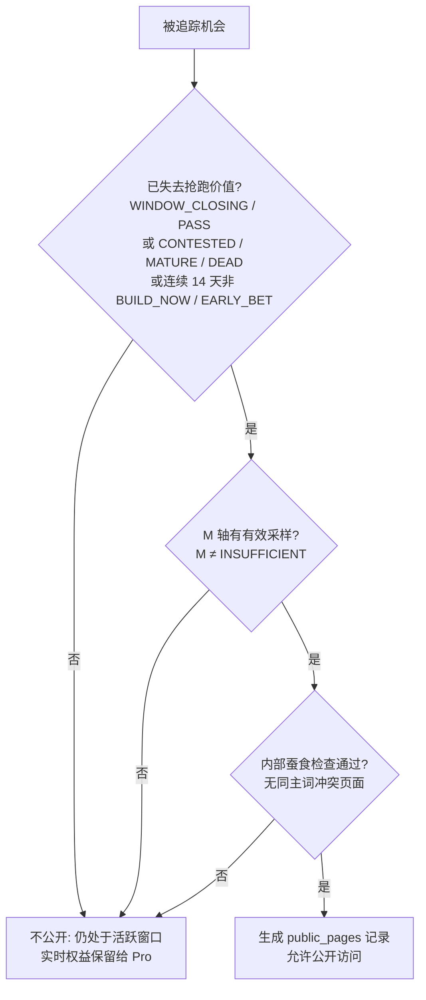

# 15 — 公开获客层与发布流水线规格（Public Site & Publication Spec）

Status: Draft ｜ Owner: 前端/增长 ｜ Last reviewed: 2026-10-18（对齐 PRD v3.1：废除槽位、买断与 45 天/固定 14 天延迟）｜ 依赖：01 §7、05 §5.1/§6、06 §6.1、13 §3.2、03 §15、14 ｜ 被依赖：16、19

## 1. 目的与原则

公开获客层（Public Projection Layer）是系统的自然增长与信任建立基石。SEO（搜索引擎优化）与 GEO（生成式 AI 引擎优化）不是外围营销项目，而是产品系统架构的原生组成部分。

**核心原则（01 §7.1）**：
1. **公开 = 准实时样本 + 有结果，且不泄露活跃窗口**：公开层发布的是**已经失去抢跑价值**的机会——当前裁决为 `WINDOW_CLOSING` / `PASS`，生命周期已进入 `CONTESTED` / `MATURE` / `DEAD`，或连续 14 天不再是 `BUILD_NOW` / `EARLY_BET`。它绝不提前泄露仍在活跃窗口内的实时判断。**这不是"45 天延迟公开"，也不是"固定 14 天延迟"**：时间只是失去抢跑价值的判据之一，不是等待期；一条刚发布就关窗的机会当天即可公开，一条长期保持 `BUILD_NOW` 的机会永远不公开。
2. **纯投影架构（Projection-only）**：公开页面绝不直接跨库读取受限业务表，而是由每日批处理流水线（S8）计算出的 `public_pages` 及公开投影物化视图生成，物理隔离内部数据。
3. **真实数据呈现**：公开站（包括 Landing 页与战绩页）严禁使用抽象概念插画或模拟数据，必须使用真实产品界面、来源、观测日期和结果回流。**前台主打 Cohort Hit Rate & Accuracy Matrix 与事后复盘；Merkle 树等密码学存证作为后台审计手段，前台只在页脚保留一个校验入口**，不作为卖点宣传。账本还不能同时列出命中和失误时，Landing 不写预测准确率、不写未登记的查询体量。允许写的是观测起始日、已追踪查询数、研究市场，以及指向 `/methodology` 与 `/track-record` 的链接。
4. **质量门槛与防降权护栏**：Programmatic SEO 必须遵守严密的质量检查；不满足内容丰富度与独特性的页面强制输出 `noindex`，严禁产生低质薄内容。
5. **无槽位、无买断的单一公开口径**：PRD v3.1 已删除 `opportunity_slots` / `slot_claims` / `stealth_locks`。公开层不再有"满额解锁""60 天打码""期满解密"等分支；所有机会走同一套 §3 资格判据，公开页也不会因为付费动作而改变可见性。

---

## 2. 公开页面范围与路由

| 路由路径 | 页面类型 | 渲染策略 | 数据源 | 核心转化目标 |
|----------|----------|----------|--------|--------------|
| `/` | 官网首页（Landing） | ISR（24h） | 平台聚合统计 + 来源与结果片段 | 注册 / 预售转化 |
| `/pricing` | 价格与套餐 | 静态（SSG） | `13-BILLING-RBAC` 配置快照 | Checkout 结账 |
| `/methodology` | 方法论与证据规范 | 静态（SSG） | 00、05、06、07 规范公开摘要 | 建立专业信任 |
| `/data-sources` | 数据源登记与合规 | 静态（SSG） | 04 登记表脱敏公开视图 | 消除合规疑虑 |
| `/track-record` | 预测战绩公开大盘 | ISR（每日 S8 刷新） | `public.track_record_summary` + Episodes | 展示判断如何经受结果检验，驱动 Pro 转化 |
| `/opportunities/[slug]` | 准实时精选机会公开页 | ISR / 按需生成 | `public_pages` (page_type='OPPORTUNITY') | 免费体验 → 注册解锁实时 Feed |
| `/case-studies/[slug]` | 已完结案例拆解页（CASE_STUDY） | ISR（按需） | `public_pages` (page_type='CASE_STUDY') | 结果背书 → Pro 转化 |

> **路径以代码为准（2026-10-13 核对）**：本节与 §6.2 写的 `/opportunities/[slug]`，
> 实际路由是 **`/public/opportunities/[slug]`**（`apps/web/src/app/public/opportunities/[slug]/page.tsx`，
> `sitemap.ts` 也按此拼 URL）。两处不是同一个页面：`/opportunities/[slug]` 是登录后的
> 应用内机会详情页，公开投影在 `/public/...` 下。规格里的写法会被读成"公开页就是那个
> 需要登录的页面"，故此处以代码为准标注，不改代码 —— 改路由会让已发布的 URL 失效。
| `/markets/[slug]` | 细分市场热度聚合页 | ISR（每周） | `public_pages` (page_type='MARKET') | 广谱长尾搜索获客 |
| `/compare/[slug]` | 精选过期对比页 | ISR（按需） | `public_pages` (page_type='COMPARE') | 比较意图搜索获客 |

---

## 3. 公开资格规则（Publication Eligibility）

> **v3.1 判据**：不再有"T+45 天""固定 14 天延迟""槽位认领满额"或"买断打码"。公开时机只看**这条机会是否已经失去抢跑价值**（01 §7.1 与术语表）。一条刚发布就关窗的机会当天即可公开；一条长期保持 `BUILD_NOW` 的机会永远不公开。

一个 Opportunity 必须**同时满足以下全部条件**，S8 批处理流水线才允许为其生成公开投影并推入发布队列：



1. **已失去抢跑价值（准入条件，D12）**：该机会必须处于下列之一——
   - 当前裁决为 `WINDOW_CLOSING` 或 `PASS`；或
   - 生命周期为 `CONTESTED` / `MATURE` / `DEAD`；或
   - 已连续 14 天不再是 `BUILD_NOW` / `EARLY_BET`（按 `verdicts` 连续段起始日计算，含端点；参考日取账本最新一行，不取挂钟）。
   **仍处于 `BUILD_NOW` / `EARLY_BET` 的机会一律不得公开**——这是硬阻断，S8 在资格断言阶段即拒绝，不进入质量审查。
2. **证据充足性**：商业信号 M 轴不得为 `INSUFFICIENT`；必须具备确凿的定价或商业意图记录。
3. **蚕食防护（Cannibalization Check）**：该机会的核心 Query 与现有已收录公开页的相似度不得过高（Jaccard Top10 重叠度 `< 0.7`），避免自身网站在 Google 中产生关键词冲突。
4. **无额外分支**：v3.1 没有槽位满额旁路、没有买断保护期分支。所有机会走同一套 1–3 条判据。

> **实现口径（`packages/services/src/publication-policy.ts`）**：
>
> 1. **"连续 14 天非活跃"按 `verdicts` 的连续段起始日判定，含端点，当日满足当日即可公开。** 不能只看当前 `verdict`：迟滞会让一条机会在 `WINDOW_CLOSING` 停留 30 天；也不能用 W 降档做代理——`PASS`、生命周期转换等路径不一定伴随 W 降档。
> 2. **蚕食防护的"已收录"= `status='PUBLISHED' AND indexable = true`**，与 `sitemap.ts` 同一口径（未过质检的页不会被收录，不构成关键词冲突）；比对对象是两侧 PRIMARY query 最新 SERP 快照的 **Top10 结果 URL 集合**（归一后），`>= 0.7` 阻断。没有已收录页是 `VACUOUS`（通过），有页但一侧拿不到快照是 `NOT_EVALUATED`（**阻断**并登记进 `notEvaluated`）。后者取 fail-closed 是刻意的——一旦有页可被索引，蚕食就是真问题，静默放过等于让这条检查形同虚设。
> 3. **相似度的口径只有一种**：`normalizeSerpUrl` 只做下界（去 scheme / `www.` / fragment / 尾斜杠），**刻意不剥 query string**；归一化只会让两个集合更容易重叠（挡得更多、公开得更少），而"少公开"是这条判据出错时安全的那一侧。
> 4. **准入判据是每日重算的**，非单调；撤回规则见 §3.1。

### 3.1 每日重算、撤回与归档

1. **每次 S8 都按最新账本重算资格**，不缓存"曾经合格"的结论。
2. **资格仍然成立**（仍处于 `WINDOW_CLOSING` / `PASS` / `CONTESTED` / `MATURE` / `DEAD`，或持续非活跃）：公开页保持 `PUBLISHED`，内容按最新已公开快照刷新。
3. **资格失效——机会重新进入 `BUILD_NOW` / `EARLY_BET`**：同一次 S8 运行内把公开页置为 `status='DRAFT'`（URL 404，并清除 CDN 缓存）。**这一条优先于任何 SEO 保活策略**：活跃窗口泄露是 0 容忍 P0，不能用页面权重换。等它再次失去抢跑价值后，按新快照重新发布。
4. **历史归档不删除**：`public_pages` 行与快照保留，`status='DRAFT'` 只是不可公开访问；重新合格时可复用同一 slug 重新发布。
5. **不生成/不保留任何打码投影**：v3.1 没有 `stealth_locks`、`stealth_lock_displays` 或 `[Stealth Locked #ID]`；历史买断数据如仍存在，只作离线归档，不参与公开投影。

### 3.2 已公开机会的重新演进与保活策略（Re-opened Opportunities Preservation）

处于 `DEAD` / `MATURE` / `CONTESTED` 的机会仍属于"已失去抢跑价值"，其公开页继续保留：

1. **不删除、不 404**：机会仍满足 §3 资格时，页面维持 `status = 'PUBLISHED'`，保留索引权重与反向链接；
2. **只展示历史归档，不注入实时判断**：页面可以提示"该市场已有后续演进，历史归档见下"，但**不得**输出新的三轴档位、最新 verdict、竞争指标或任何实时窗口信号；实时内容仅限 Pro。
3. **重新进入活跃窗口时撤回**：一旦该机会再次成为 `BUILD_NOW` / `EARLY_BET`，按 §3.1 第 3 条立即 `DRAFT`，而不是靠横幅继续展示。等它再次失去抢跑价值后重新发布。
4. **转化价值**：重新活跃的历史页面在撤回前仍是真实战绩背书与付费漏斗入口；撤回后由 `/track-record` 的聚合统计继续承载其历史结果。

---

## 4. 发布流水线（Publication Pipeline）

每日批处理 S8 阶段按照以下 8 步标准工序执行：

```text
S6 账本更新完成
  │
  ▼ 1. 投影提取（Public Projection）：提取满足条件的数据投影，脱敏用户数据
  │
  ▼ 2. 资格断言（Eligibility Rules）：运行 §3 的"失去抢跑价值 / 证据 / 蚕食"三道门槛；
  │     仍处于 BUILD_NOW / EARLY_BET 的活跃窗口在此被硬阻断
  │
  ▼ 3. 战绩聚合（Cohort Aggregate）：重算 Cohort Hit Rate 与 Accuracy Matrix，
  │     基数为全部已到期 Episode，不因是否公开而剔除任何一条
  │
  ▼ 4. 本地化渲染（Localized Render）：基于 14 规则生成 en-US 与 zh-CN 页面内容
  │
  ▼ 5. 质量审查（Quality Gate）：运行 §5 自动化质检（字数、引用、结构完整性）
  │
  ▼ 6. 索引决策（Indexability Decision）：通过质检标 indexable=true，未通过标 false
  │
  ▼ 7. 静态持久化（Persistence）：写入 public_pages 表并触发 Next.js revalidateTag()
  │
  ▼ 8. 站点地图与内链更新（Sitemap & Graph）：增量更新 sitemap.xml，重新计算主题内链
```

---

## 5. 质量审查门槛（Quality Gate）与索引策略

为防止生成大量低质长尾页面遭受 Google Helpful Content 算法打击，每个拟公开页面必须通过自动质检评级：

| 检查项 | 指标与通过线 | 未通过处置 |
|--------|--------------|------------|
| **正文有效字数** | 正文纯文本 ≥ 600 词（英文）/ 800 字（中文） | `indexable = false` |
| **证据事实密度** | 页面内有效可追溯的 `evidence_id` 引用数 ≥ 3 条 | `indexable = false` |
| **商业证明完备性** | “证明了什么 / 未证明什么”两栏均非空且有具体事实支撑 | `indexable = false`（阻断发布） |
| **SERP 弱度具体性** | 列出 ≥ 1 个具体弱竞争对手 URL 与弱度理由 | `indexable = false` |
| **模板文本率** | 非模板动态内容占比 ≥ 40% | `indexable = false` |

### 5.1 索引控制机制
* **通过质检**（`indexable = true`）：
  - 允许被搜索引擎抓取并收录：`<meta name="robots" content="index, follow">`；
  - 自动注入对应语言的 `sitemap.xml`。
* **未通过质检**（`indexable = false`）：
  - 页面物理存在（用户仍可通过直接链接访问），但输出：`<meta name="robots" content="noindex, follow">`；
  - 不纳入 `sitemap.xml`，防止稀释整站 SEO 权重。

---

## 6. SEO & GEO 结构化数据规格

所有公开页必须在 Next.js 服务端渲染输出标准的 JSON-LD 结构化数据，确保传统搜索引擎与 AI 检索代理（Perplexity、SearchGPT、Google AI Overviews）能够精确抽取事实。

### 6.1 战绩页（`/track-record`）
注入 `Dataset` 结构，声明公开决策记录的时间范围、研究市场和结果指标；不要在结构化数据中暴露内部账本实现：
```json
{
  "@context": "https://schema.org",
  "@type": "Dataset",
  "name": "Emeradar Search Opportunity Decision Outcomes",
  "description": "Source-backed search opportunity decisions tracked against later market outcomes.",
  "license": "https://emeradar.com/methodology",
  "temporalCoverage": "2026-09-01/..",
  "spatialCoverage": "US",
  "variableMeasured": ["Demand Formation", "Entry Window", "Market Formation Outcome"]
}
```
**战绩展示口径**：以 Cohort Hit Rate（按 Verdict 类型 / 观测月份分组的 T+30/60/90 命中率）与 Accuracy Matrix（BUILD_NOW 在公开后 90 天内进入 `CONTESTED` 的比例）为主，**始终同时列出命中与失误**。全部已到期 Episode 都进入分子分母，不因机会是否已有公开页而剔除；任何可按单条反推词根的聚合切片须做最小分组量抑制（`k ≥ 5`）。

### 6.2 准实时精选机会详情页（`/opportunities/[slug]` 与 `/case-studies/[slug]`）

> 实际路由见 §2 表格下方的核对说明：`/public/opportunities/[slug]`。
注入 `Article` 与 `ItemPage` 复合结构：
```json
{
  "@context": "https://schema.org",
  "@type": "TechArticle",
  "headline": "Search Market Analysis: {title_original}",
  "datePublished": "{first_observed_at}",
  "dateModified": "{obs_date}",
  "author": { "@type": "Organization", "name": "Emeradar Intelligence Engine" },
  "about": {
    "@type": "Thing",
    "name": "{primary_query_text}"
  }
}
```

已完结案例页（`/case-studies/[slug]`，`page_type='CASE_STUDY'`）在该机会满足 §3 资格后生成，额外注入 `ClaimReview` 式的结果回流声明与真实结果时间线：
```json
{
  "@context": "https://schema.org",
  "@type": "TechArticle",
  "headline": "Case Study: {title_original} — {outcome_label} in {days} days",
  "datePublished": "{first_observed_at}",
  "dateModified": "{revealed_at}",
  "about": { "@type": "Thing", "name": "{primary_query_text}" },
  "mentions": [{ "@type": "CreativeWork", "name": "{user_project_url}" }]
}
```

> **JSON-LD 与实时性约束**：公开页的结构化数据只能引用该页已发布快照中的事实，**不得**注入尚未公开的最新 verdict、三轴档位或竞争指标。若机会重新进入 `BUILD_NOW` / `EARLY_BET`，页面按 §3.1 第 3 条撤回，JSON-LD 也随之消失；不存在"页面归档但结构化数据仍在泄露实时状态"的路径。

---

## 7. 站点地图与内链拓扑（Hub-and-Spoke）

1. **分级 Sitemap**：
   - `/sitemap.xml`：索引总表；
   - `/sitemap-core.xml`：主站静态营销页（Landing、Pricing、Methodology 等）；
   - `/sitemap-opportunities-{yyyy-mm}.xml`：按月切分的准实时精选归档地图（仅包含 `indexable = true` 的页面；不符合 §3 资格或已撤回的页面不会出现）；
   - `/sitemap-markets.xml`：市场主题聚合页；
   - `/sitemap-case-studies.xml`：已完结案例拆解页（解密后生成）。
2. **主题内链架构（Hub and Spoke）**：
   - 每个市场主题页（Hub，如 `/markets/developer-tools`）自动聚合该主题下全部已公开的准实时精选机会（Spokes）；
   - 处于同一聚类（Cluster）内的机会页面之间互相呈现相关比较链接，形成网状互链；
   - 每个机会页面底部固定引导链接："查看该机会的公开战绩与结果记录（Track Record）"。

---

## 8. 监控与反作弊指标

| 指标 | 目标线 | 预警线 | 处置措施 |
|------|--------|--------|----------|
| **GSC 索引率（Index Coverage）** | `indexable` 页面索引率 ≥ 80% | < 60% | 调高质检门槛，暂停新页面索引提交，全面排查薄内容 |
| **软 404 / 抓取异常率** | < 0.5% | > 2% | 触发 P1 运维告警，检查 Next.js ISR 路由异常 |
| **爬虫抓取预算消耗（Crawl Budget）** | Googlebot 日常正常抓取 | 突发 > 10× 异常抓取 | 检查是否存在死循环内链，开启边缘 CDN 频率限制 |
| **活跃窗口泄露率** | 0 容忍（仍处于 `BUILD_NOW` / `EARLY_BET` 的机会严禁出现在任何公开投影） | > 0 | **P0 事故**：立即下线公开投影流水线并全量清除 CDN 缓存；复查 S8 资格断言的"失去抢跑价值"判据与 §3.1 撤回逻辑 |
| **Cohort 统计口径完整率** | 100%（全部已到期 Episode 均进入分子分母） | < 100% | **P0 事故**：战绩可信度直接受损；暂停 `/track-record` 发布，回查 §4 第 3 步的聚合实现 |
