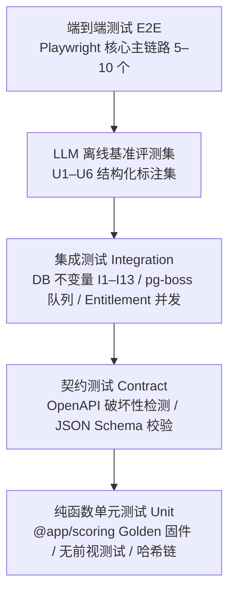
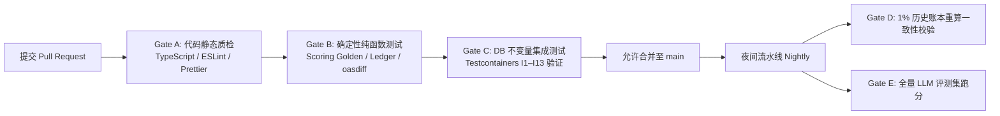

# 18 — 测试策略与质量工程规格（QA & Test Strategy）

Status: Draft ｜ Last reviewed: 2026-10-18（对齐 PRD v3.1：GO 配额、无槽位/质押/买断）｜ 依赖：01 §3 & §10、05 §10、06 §5、08 §10、09 §7 ｜ 被依赖：19

## 1. 目的与原则

本系统以“**不可篡改的预测战绩与可审计的证据链**”为核心信誉资产。任何评分不确定性、哈希链断裂、LLM 幻觉或数据泄露都将直接摧毁产品立足之本。

**核心原则**：
1. **确定性第一**：评分纯函数（`@app/scoring`）与账本哈希链（`@app/ledger`）实行 100% 严苛的 Golden 测试，杜绝跨架构、跨版本的浮点与时间漂移；
2. **LLM 结果必须经过确定性严查**：大模型生成的内容必须通过编译期般的自动化断言（Schema、硬数字占位符保真度、证据引用有向图），评测集纳入常规 CI；
3. **数据库不变量自动断言**：DDL 中的 I1 至 I13 不变量必须在 CI 集成测试中执行主动攻击测试；
4. **测试分层与轻量敏捷**：2–3 人团队不维护冗杂低效的低质用例，重点构建高价值契约测试与金字塔分层保障。

---

## 2. 测试分层金字塔（Test Pyramid）

---

## 3. 单元测试（Unit Testing）

### 3.1 `@app/scoring` 确定性评分测试（05 §10）
* **Golden 测试固件（Fixtures）**：
  * 在 `packages/scoring/test/fixtures/` 维护包含典型行业机会输入与上一日状态的快照集；
  * 断言：同一 `ScoringInput` 无论在 ARM64（开发机）还是 x86_64（CI 容器），生成的 `ScoringOutput`（三轴分档、Verdict、`explanation`）必须 **bit-for-bit 完全一致**；
* **边界与极端值**：
  * 阈值边界测试（Score = 74.99 vs 75.00，验证无浮点舍入跳档）；
  * 极端数据：宇宙规模 `< min_universe_size` 时 D 轴必须正确归为 `INSUFFICIENT` 并附带 `PARTIAL_DATA`；
* **严格无前视断言（No-Lookahead Test）**：
  * 向特征构建器注入 `observed_at > obs_date 23:59:59Z` 的未来快照数据，断言输出的分数与 Verdict 绝对不发生任何变化。

### 3.2 `@app/ledger` 哈希链与 Checkpoint（06 §4）
* **RFC 8785 JCS 规范化测试**：验证 JSON 键排序、浮点表示在极端字段下的哈希稳定性；
* **RFC 6962 Merkle 树断言**：测试奇数叶子节点、空节点与跨天串联的前后依赖一致性。

### 3.3 Query 规范化（14 §3）
* 运行 100+ 边界词测试集（含重音、多空格、全角符号、C++、.NET 等保护词），验证 `text_normalized` 的确定性。

---

## 4. 集成测试（Integration Testing）

采用 Testcontainers 或独立 PostgreSQL 测试容器，重点验证系统不变量与并发安全性：

| 测试用例模块 | 攻击场景与测试动作 | 预期断言 |
|--------------|--------------------|----------|
| **不变量 I1** | 应用角色执行 `DELETE FROM verdicts` 或 `UPDATE evidence` | 数据库触发器直接抛出 SQL 异常，操作被强行回滚 |
| **不变量 I2** | 尝试针对同一 `(opportunity_id, obs_date)` 插入两条 `is_override = false` 的行 | 命中唯一部分索引，抛出唯一键冲突 |
| **不变量 I8** | 创建机会时未关联 `role = 'PRIMARY'` 的查询，或尝试关联两条 PRIMARY 查询 | 事务中断或抛出排他唯一索引错误 |
| **配额并发预占** | 10 个并发线程同时发起 `EntitlementService.reserve()`，此时配额仅剩 1 | **恰好 1 个线程成功**，其余 9 个立即返回 `QUOTA_EXCEEDED`，`used` 计数器最终严格等于上限，绝无超卖 |
| **两级爬取降级** | 模拟 SPA 壳页面返回空文本，触发 Tier 2 检测 | 确认 `fetch_tier` 被标记为 `HEADLESS`，并正确调用无头浏览器驱动 |
| **S6 咨询锁互斥** | 两个 Worker 实例同时对同一 `obs_date` 调度 S6 账本归档 | 一个持有 `pg_advisory_lock` 执行批量写入，另一个跳过执行，绝不重复生成行哈希 |

### 4.1 交付闭环、GO 配额与反滥用用例（PRD §1.8、ADR-018、ADR-021）

以下用例覆盖首发商业闭环与防白嫖机制，均为发布前必过项：

| 用例 | 场景与测试动作 | 预期断言 |
|------|----------------|----------|
| **Fast-Track 快车道（05 §5.0）** | 机会 `history_days = 8`、`new_queries_7d = 4` 且斜率显著 | 允许以 7 天历史进入资格评估并打 `FAST_TRACK`；**不**因 < 14 天落入 `WATCH` + `PARTIAL_DATA` |
| **特征补偿 `RULE_BUILD_NOW_COMPENSATED`（05 §5.1）** | D=HIGH、W=HIGH、M=MEDIUM（≥2 独立定价站或初现交易代理）、conf ≥ MEDIUM | `raw_verdict = BUILD_NOW`，`explanation` 命中 `RULE_BUILD_NOW_COMPENSATED`；M=LOW 或无 observed 证据时**不得**补偿 |
| **GO 无槽位并发（ADR-018、10 §4.3）** | 4 个各余 1 次配额的用户分别对 4 条不同裁决并发 `POST /go`；随后同一用户对同一 `decision_id` 再 GO 一次 | 4 个请求全部 `201`，各自建出 Project 并解锁点火包，`usage_counters.used` 各 +1；重复请求返回 `409 ALREADY_GO` 且配额**不重复扣减**。库中不存在任何 `opportunity_slots` / `slot_claims` 读写 |
| **GO 配额与结转（13 §4.2）** | Pro 用户当月用满 3 次，次月再 GO 4 次；另测 Free 用户 GO | 次月可用余额为 3 + 3（上限 6），第 7 次返回 `403 QUOTA_EXCEEDED`；Free 返回 `403 PLAN_REQUIRED` |
| **凭证核验可选且与配额解耦（13 §4.3、03 §17）** | ① GO 后不提交任何凭证；② 提交 `DOMAIN_URL` 并写入 `META_TOKEN`；③ 提交错误 token；④ GO 后等待超过任意历史"质押窗口" | ① Project 存在、`credential_status='UNVERIFIED'`、点火包可用；② 转 `VERIFIED_OWNER` 并开启排名追踪；③ 转 `REJECTED`；④ 不释放任何资源、不退还配额。凭证核验没有截止时间 |
| **已删除机制不存在（v3.1）** | 扫描 schema、迁移、API 路由与服务层 | 不存在 `stealth_locks` / `stealth_lock_displays` / `STEALTH_BUYOUT` / `stake_status` / `active_go_slots_max`；没有买断或打码端点；任何付费动作都不改变机会可见性 |
| **反滥用-邮箱归一化（13 §7.1、17 §2.5）** | 同一自然人用 `j.doe+free@gmail.com` 与 `jdoe@gmail.com` 先后注册领取终身免费初筛 | 归一为同一 `canonical_email`，第二次领取被拒；非 Gmail 域**不**剥离点号（不同人不得误合并） |
| **反滥用-指纹 30 天限流（03 §2）** | 同一 `fingerprint_hash`/`ip_hash` 30 天内第二次触发免费实时初筛；随后注销账户并重注册 | 第二次被拒；注销后 `lifetime_scan_grants` 哈希**保留**（`user_id` 置 NULL）、`device_fingerprints` **删除**，重注册仍无法再领 |
| **两阶段初筛与半遮罩可见性（F3）** | Free 用户提交自定义词；Pro 用户提交同词 | 第 1 阶段 5 秒内返回静态初筛卡；Free 的具体弱结果 URL、收钱竞品域名与 15 长尾词在**API 响应与渲染层双重不可得**（高斯模糊），Pro 全量可见 |
| **`STALE_DATA` 72h 宽限（ADR-021、05 §5.3）** | 某源 72 小时内偶发失败 | 沿用最近成功快照档位并打 `STALE_DATA`；**不发布降档 Verdict、不投递降级告警**；连续失败 73 小时后该轴才置 `INSUFFICIENT` 并恢复降档与告警 |
| **`WINDOW_CLOSING` 的 14 天约束（05 §5.1）** | ① 降档发生在 `obs_date` 前 14 天内且 `prev.verdict ∈ {BUILD_NOW, EARLY_BET}`；② 降档发生在 30 天前或无前置已发布裁决 | ① 触发 `WINDOW_CLOSING`；② **不得**触发，低 W 只能落入 `WATCH` 或 `PASS` |
| **公开资格-活跃窗口一律不得公开（15 §3 第 1 条、§8，0 容忍）** | 一条当前 `BUILD_NOW` 与一条 `EARLY_BET` 的机会进入 S8 发布循环 | 两条均 `public_pages.status = 'DRAFT'`、`eligibility.admission.basis = null`、`blockedBy` 含 `ACTIVE_WINDOW`；`/public/*` 全响应体扫描不到该机会 |
| **公开资格-失去抢跑价值即可公开（15 §3 第 1 条）** | ① 首见仅 3 天的 `WINDOW_CLOSING`；② `PASS`；③ `MATURE`；④ 连续 14 天非 `BUILD_NOW` / `EARLY_BET` | 四条均在**当天**允许公开（`status='PUBLISHED'`）；`admission.basis` 分别为 `WINDOW_CLOSING` / `PASS` / `LIFECYCLE_CLOSED` / `INACTIVE_14D`。旧判据（`ageDays >= 45`、槽位满额、买断）在这里不得再出现 |
| **公开资格-14 天连续段的边界与粘滞（15 §3 第 1 条）** | ① 连续段起点恰在 14 天前；② 15 天前；③ `verdict` 仍为 `WINDOW_CLOSING` 但该连续段起点在 25 天前 | ① 公开（**含端点**）；② 不公开；③ 仍可公开，因为 `WINDOW_CLOSING` 本身已满足"失去抢跑价值"——断言实现读的是判据组合，而不是"是否刚跨过某条线" |
| **公开资格-非单调撤回（15 §3.1 第 3 条）** | 取一条已 `PUBLISHED` 的公开页，把账本推到该机会重新成为 `BUILD_NOW` 的当天再跑 S8 | 该页在同一次运行内被置为 `DRAFT`，`/public/opportunities/{slug}` 变 **404** 且 CDN 缓存被清除；不得用横幅或"历史归档"继续展示实时信号 |
| **蚕食防护（15 §3 第 3 条）** | 候选与各已收录页的 SERP Top10（归一后）算 Jaccard：① 重叠 8/10；② 重叠 9/10；③ 库里一条已收录页都没有；④ 有已收录页但候选拿不到 SERP 快照；⑤ 已收录页是 `indexable = false` 的页 | ① `PASSED`（≈0.667 < 0.7）且放行；② `BLOCKED`（≈0.818 ≥ 0.7）且 `blockedBy` 含 `CANNIBALIZATION`；③ `VACUOUS`（**不得**报成"数据缺失"）；④ `NOT_EVALUATED`、fail-closed 阻断并登记 `notEvaluated`；⑤ 不计入参照集 → 退回 ③。**必须断言候选自己不与自己重叠**（否则一条已发布页在复审时被自己挡成 `DRAFT`，永远翻不回来） |

### 4.2 PRD 验收追溯补齐（R18，见 30 §3）

本节补齐 PRD 中有验收条款、此前没有对应测试的项。每条用例对应的实现任务见 `31` §2 的「验收」列。

| 场景 | 输入 / 方法 | 断言 |
|------|-------------|------|
| **F7 构造集①：僵尸定价站** | ≥ 2 个独立域名仅检测到支付 provider / 定价页，90 天内排名、评论、外链均无正增长 | M ≠ `HIGH`；标 `PRICING_DECORATION` |
| **F7 构造集②：矛盾证据** | 同一域名同时有 observed 定价与"已下架付费层"的负面信号 | M ≠ `HIGH`；两条证据都保留并在详情两栏中可见，不得互相覆盖 |
| **F7 构造集③：估算无佐证** | 只有 `THIRD_PARTY_ESTIMATE` 流量 / 营收，无 observed 证据 | M ≠ `HIGH`；估算权重为 0，仅展示 |
| **成本回归** | 按 04 §6.1 新公式（按页计费、Fast Lane 项、用户分摊项）与 Gate 0 实测单价计算 | 能反推 04 §6.4 两条目标（单付费用户 < $1/月；500 用户新增边际 SERP 成本 < $20/月），或输出不达标的明确差额；单价或公式变更时必须重跑 |
| **H1 评估流程** | 按 `ev-1.1`（06 §7）计算 `external_demand_formed`；对照 B0 随机、B1 Trends（必备）、B2 朴素启发式 | 只读 `hash_version ≥ 2` 的 v2 纪元行，seed 行出现即失败；判据取自 Episode 的 `criteria_snapshot`；报告同时给出命中与失误清单、95% CI；样本 < 100 时标"样本不足" |
| **H4 评估流程** | 已核验 Project 的 `verified_launch_within_7d` 与 `serp_top100_within_30d`（06 §7.1） | 两个口径均不读 GSC；未连接 GSC 的项目不得因此判失败；关联项目 < 30 时只出内部报告 |
| **Gate 0 一次性全量重算** | 对 v2 纪元全部 Verdict 执行 05 §8 `recompute`（不是夜间 1% 抽样） | 与账本逐行 bit-for-bit 一致；任一不一致即 Gate 0 不通过 |
| **Golden：快车道可达** | 历史 7–13 天、`new_queries_7d ≥ 3` 且加速度达标、D ≥ MEDIUM、W = HIGH | 进入资格评估并标 `FAST_TRACK`，可产出 `EARLY_BET`；同条件但不满足脉冲判据时维持 `WATCH` + `PARTIAL_DATA` |
| **Golden：B 层 W 新鲜度** | B 层机会最近一份 SERP 快照距 `obs_date` 4–8 天 | W 不因新鲜度置 `INSUFFICIENT`；第 9 天起置 `INSUFFICIENT`；A 层超过 3 天即置 |
| **Golden：INFERRED-only 的 EARLY_BET** | D = HIGH、W ≥ MEDIUM、M 仅有 `INFERRED` 商业意图证据 | 可发布 `EARLY_BET`（带"商业未验证"）；不得为 `BUILD_NOW` |
| **Golden：补偿 BUILD_NOW 需交易证据（Q1）** | D = W = HIGH、M = MEDIUM，三组：①仅 ≥ 2 站静态定价；②含 `COMMERCIAL_TRACTION`；③定价持续 ≥ 90 天 | ① 最多 `EARLY_BET`，不得为 `BUILD_NOW`；②③ 为 `BUILD_NOW` 并标 `RULE_BUILD_NOW_COMPENSATED` |
| **Golden：拥挤度不进入 W（05 §5.2、§5.6）** | 前置已发布 `BUILD_NOW`；14 天内 `verified_product_count` 由 1 升到 3、`new_top10_entrants_30d` 由 0 升到 2 | `W_score` 与 `raw_verdict` **不变**，不进入 `WINDOW_CLOSING`；仅产生 `CROWDING_SIGNAL` 告警并触发 `EARLY_WINDOW → CONTESTED` 生命周期转换（若前置为 `EARLY_WINDOW`） |
| **凭证核验方法矩阵（09 §8、03 §17）** | 分别以 `META_TOKEN` / `DNS_TXT` / `STORE_OAUTH` / `GITHUB_FILE` / `GITHUB_RELEASE_ASSET` 提交正确与错误凭证 | 正确凭证使项目转 `VERIFIED_OWNER` 并开启排名追踪；错误凭证转 `REJECTED`；同一项目至多一条 `VERIFIED_OWNER`，重复核验被唯一索引拒绝 |
| **GO 配额不因任何后续事件回补** | ① 凭证核验失败；② 项目归档；③ 机会转为 `PASS` | 三种情况下 `GET /billing/usage` 的 `used` 均不减少；没有 `refund` 路径（GO 事务自身回滚除外） |

---

## 5. 契约测试（Contract Testing）

* **OpenAPI 兼容性断言**：
  * CI 中从 Zod 领域模型动态生成 `openapi.json`，使用 `oasdiff` 与主分支基线比对；
  * 若存在未经显式批准的破坏性变更（Breaking Change，如删除字段、修改枚举类型），直接阻断 PR 合并；
* **机会报告 Schema 校验**：
  * 校验生成的报告 JSON 是否 100% 符合 `packages/report/schema/report-1.0.json` 规范。

---

## 6. LLM 评测集体系（Evaluation Suites）

评测用例集纳入独立版本化目录 `packages/llm/evals/`，分为快速抽样集（PR 阻断）与全量评测集（夜间执行）：

| 任务 | 评测集规模 | 黄金标准来源 | 核心指标与门槛 | 执行频率 |
|------|------------|--------------|----------------|----------|
| **U1 实体归并** | 300 对同义/近邻候选 | 人工双盲标注 | 自动归并准确率 ≥ 95% | 夜间 |
| **U2 SERP 分类** | 500 个真实 SERP 网页 | 资深 SEO 分析师标注 | `result_type` 宏 F1 ≥ 0.85；`is_specialist` F1 ≥ 0.88 | 夜间 |
| **U3 定价抽取** | 200 个多样化定价页 | 人工提取真实价格表 | 价格数值与套餐名称精确匹配率 ≥ 98% | 每次 Prompt 修改 |
| **U4 解释文本** | 50 条每日 Why Now 样本 | 事实包与生成比对 | 自动占位符解析率 100%；事实一致性 ≥ 95% | PR 抽检 |
| **U5 机会研究报告** | 20 份真实机会报告样本 | 见 §7 评测计分卡（Rubric） | **Rubric 得分 ≥ 7/8 且 R1、R2 零容忍项 100% 达标** | 发布新模型前 |
| **U6 本地化** | 每语言 100 组翻译对 | 双语对比 | 占位符、硬数字与证据引用保真度 100% | PR 抽检 |
| **U7 点火包装配** | 每个 Build Type / 形态各 10 份 | 见 §7.1 点火包 rubric（L1–L6） | **Rubric 得分 ≥ 5/6 且 L1、L2 零容忍项 100% 达标** | 发布新模型前 |

---

## 7. 机会研究报告评分体系（Rubric Scorecard，09 §7）

由 2 名独立评审对生成的机会分析报告执行双盲评审打分：

| 维度 | 检查内容 | 分值 | 一票否决？ |
|------|----------|------|------------|
| **R1. 事实引用有效性** | 文中所有事实陈述必须附带合法证据引用，且数字由确定性占位符正确渲染 | 1 分 | **是（未通过总分记 0）** |
| **R2. 零编造（No Hallucination）** | 不存在未经快照佐证的凭空捏造竞品、虚构价格或虚假市场结论 | 1 分 | **是（未通过总分记 0）** |
| **R3. 占位符渲染完整性** | 报告最终渲染文本中绝不残留未解析的 `{{Fx.field}}` 占位符 | 1 分 | 否 |
| **R4. SERP 弱点客观性** | 竞品与弱对手分析明确对应到 Top10 快照中的弱结果 URL | 1 分 | 否 |
| **R5. 变现建议诚实度** | 变现路径严格受 M 轴证据强度约束，未经验证必须明确标明 | 1 分 | 否 |
| **R6. 推荐形态合理性** | 出货形态符合搜索意图矩阵（高交互做 Tool，聚合做 Directory/PSEO） | 1 分 | 否 |
| **R7. 止损红线明确度** | 必须包含至少 1 条可落地的 Kill Criteria 条件 | 1 分 | 否 |
| **R8. 时效与免责声明** | 明确标注观测基准日，附带标准免责声明 | 1 分 | 否 |

### 7.1 点火包评分体系（Launch Kit Rubric，09 §5）

PRD §3.3 要求「机会报告与点火包 rubric 通过率」并列达标，故除报告 R1–R8 外，另设点火包（按所选 Build Archetype 动态装配）rubric，由 2 名独立评审双盲打分：

| 维度 | 检查内容 | 分值 | 一票否决？ |
|------|----------|------|------------|
| **L1. 形态绑定一致性** | 点火包形态与 GO 所选 Build Archetype 一致，未混入其他形态的模板或词表 | 1 分 | **是（未通过总分记 0）** |
| **L2. 硬数据占位符注入** | 词表、竞品价格、搜索动量等硬数字 100% 由确定性模板注入，无 LLM 编造（ADR-019） | 1 分 | **是（未通过总分记 0）** |
| **L3. PSEO 词表可导入** | `slug` / 关键词 / 建议 `<title>` / `<h1>` / Meta 模板齐全，可直接导入 Next.js / Astro 路由 | 1 分 | 否 |
| **L4. 工程规范可执行性** | `CLAUDE.md` / `.cursorrules` 的技术栈、MVP 边界、避坑指南具体可执行 | 1 分 | 否 |
| **L5. 落地页文案证据锚定** | Hero / 痛点 / 定价文案锚定 F7 已观测证据，未越出 M 轴证据强度 | 1 分 | 否 |
| **L6. 语言边界正确** | 词表与落地页文案保持 `research_language`（`en-US`），仅说明文字随 `ui_locale`（14 §5.4） | 1 分 | 否 |

通过线：**≥ 5/6 且 L1、L2 零容忍项 100% 达标**。点火包 rubric 与报告 rubric 分别统计，任一不达标不得放行 Gate 0 / Gate 1。

---

## 8. 端到端自动化测试（E2E Testing）

基于 Playwright 编写 3 条核心用户黄金链路（运行于 Staging 回放环境，不消耗生产预算）：
1. **Onboarding → Feed 决策流**：新用户完成 4 问偏好问卷 → 浏览 Feed → 筛选 S 级周末工具 → 打开 Detail → 展开证据抽屉查看证据 → 点击 `GO` 并输入理由；
2. **机会报告导出 → Project 立项流**：针对 GO 状态机会触发生成 → 验证报告 6 大分析板块正常渲染 → 一键导出 Markdown / PDF / JSON → 原子 GO（选择 Build Archetype，同一事务内扣 1 次配额 + 建 Project + 解锁该形态点火包）；
3. **公开站 SEO 渲染流**：访问 `/track-record` 验证 Cohort Hit Rate & Accuracy Matrix 渲染与底栏 Merkle 根校验入口正常 → 访问**准实时精选机会页**（已失去抢跑价值口径，PRD §7.1 已废除 45 天延迟、槽位满额与买断解锁）验证 `noindex` / `indexable` 标签符合预期，且活跃 `BUILD_NOW` / `EARLY_BET` 机会返回 404。

---

## 9. 持续交付流水线质量门禁（Quality Gates）

* **夜间账本全链自检任务（06 §5）**：
  * 从首日 Checkpoint 起，重现近 60 天全部 Verdict 的行哈希与 Merkle 根；
  * 若发现任何一行哈希不匹配，立即挂起夜间流水线并触发 P0 告警，定位快照污染来源。
